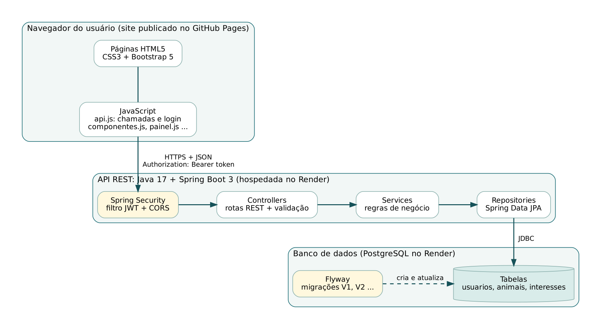

# Lar de Patas

Plataforma web de adoção responsável de animais. Quem quer adotar consulta os animais disponíveis, vê o perfil de cada um e manifesta interesse. Quem cuida dos animais (pessoas e ONGs) cadastra os bichinhos, recebe os pedidos de adoção em um painel e marca cada animal como adotado.

Projeto acadêmico de Ciência da Computação.

| Informações do trabalho | |
|---|---|
| Autor(a) | [seu nome] |
| Disciplina | [nome da disciplina] |
| Professor(a) | [nome] |
| Instituição e semestre | [instituição, semestre] |

## Demonstração

| O que | Endereço |
|---|---|
| Site | https://ggeodev.github.io/lar-dos-pets/ |
| Documentação interativa da API (Swagger) | https://lar-dos-pets.onrender.com/swagger-ui.html |

A API roda em um plano gratuito que entra em modo de espera quando fica sem uso. A primeira visita pode levar cerca de 1 minuto para carregar.

Contas de teste (senha de todas: `demo1234`): `patas@exemplo.com` (ONG, com animais e pedidos de adoção de exemplo), `maria@exemplo.com`, `joao@exemplo.com` e `vet@exemplo.com`. São dados fictícios.

## Funcionalidades

**Para quem quer adotar**
- Página inicial com animais em destaque e números reais da plataforma
- Catálogo com filtros por espécie, porte, sexo e localização
- Perfil do animal com idade, porte, saúde, temperamento e informações de adoção
- Formulário de interesse, sem precisar de conta

**Para responsáveis (com conta)**
- Criar conta e entrar
- Cadastrar animais
- Painel "Meus animais" com o total de interessados em cada um
- Ver os pedidos de adoção, com contato por WhatsApp ou e-mail
- Marcar o animal como adotado ou reabrir a adoção

## Tecnologias

| Camada | Tecnologias |
|---|---|
| Frontend | HTML5, CSS3, Bootstrap 5, Bootstrap Icons, JavaScript |
| Backend | Java 17, Spring Boot 3 (Web, Data JPA, Security, Validation) |
| Banco de dados | PostgreSQL, com migrações Flyway |
| Autenticação | Token JWT, senhas com BCrypt |
| Documentação da API | OpenAPI e Swagger UI (springdoc) |
| Testes | JUnit 5, MockMvc, banco H2 em memória, GitHub Actions |
| Publicação | GitHub Pages (site) e Render (API e banco) |

## Arquitetura



O site é estático e conversa com a API por HTTPS, enviando o token de login no cabeçalho `Authorization`. A API é dividida em camadas (controllers, services e repositories) e grava os dados no PostgreSQL.

## Como executar localmente

Requisitos: Java 17+, Maven 3.9+ e PostgreSQL (instalado ou via Docker).

**1. Banco e API** (pasta `backend`)

```
cd backend
docker compose up -d      # PostgreSQL; sem Docker, veja backend/LEIA-ME.md
mvn spring-boot:run       # API em http://localhost:8080
```

No perfil padrão (`dev`), animais, contas e pedidos fictícios são carregados quando o banco está vazio. Detalhes, variáveis de ambiente e instalação do PostgreSQL sem Docker estão em [backend/LEIA-ME.md](backend/LEIA-ME.md).

**2. Site** (pasta `frontend`)

Abra `frontend/index.html` no navegador ou rode `python3 -m http.server 5500` dentro da pasta e acesse `http://localhost:5500`. Fora do ar publicado, o site usa automaticamente a API em `localhost:8080`.

## Testes

```
cd backend
mvn test
```

São 7 testes unitários do token de login e 14 testes de integração da API (cadastro, login, permissões e o fluxo completo de adoção). Eles usam um banco em memória e rodam automaticamente no GitHub a cada push, na aba **Actions**.

## Estrutura de pastas

```
lar-de-patas/
├── frontend/              site (HTML, CSS, JavaScript)
│   ├── index.html
│   ├── pages/             catálogo, perfil, interesse, cadastro, painel, entrar, criar conta
│   ├── css/style.css
│   └── js/                api.js, componentes.js, ilustracoes.js e um script por página
├── backend/               API Spring Boot
│   └── src/main/java/com/larpatas/adocao/
│       ├── controller/ service/ repository/ model/ dto/
│       ├── security/ config/ exception/
│       └── resources/db/migration/   migrações Flyway
├── docs/                  documentação completa e diagramas
├── .github/workflows/     publicação do site e testes automáticos
└── PUBLICAR.md            passo a passo de publicação
```

## Documentação completa

A documentação do trabalho está em [docs/documentacao.md](docs/documentacao.md): requisitos, casos de uso, modelagem de dados, arquitetura, API, segurança, testes e limitações.

## Capturas de tela

<!--
Para mostrar as capturas aqui: tire os prints, salve em docs/img/ com os nomes abaixo,
apague esta linha de comentário e a linha de fechamento, e envie ao GitHub.


-->

*Capturas de tela serão adicionadas aqui.*

## Limitações e próximos passos

- As fotos dos animais são ilustrações; falta o envio de fotos reais.
- Não há recuperação de senha, confirmação de e-mail nem limite de tentativas de login.
- O catálogo ainda não tem paginação, e não é possível editar ou excluir um animal depois de cadastrado.
- A marcação de "animal em destaque" não tem tela própria.
- Por tratar dados pessoais, um projeto real precisaria de política de privacidade e consentimento conforme a LGPD.

## Créditos

Ilustrações dos animais criadas para este projeto. Ícones: [Bootstrap Icons](https://icons.getbootstrap.com/) (licença MIT). Fontes: Bricolage Grotesque e Figtree, via Google Fonts (licença SIL Open Font).
