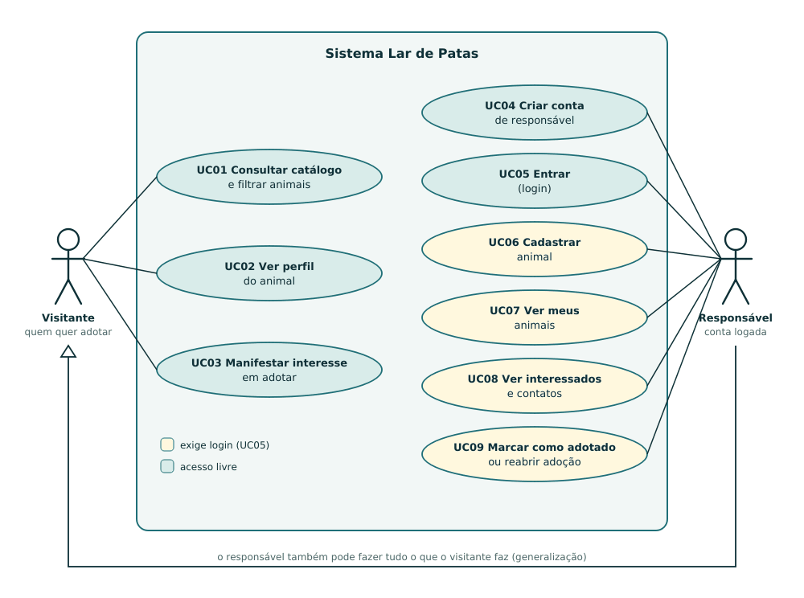
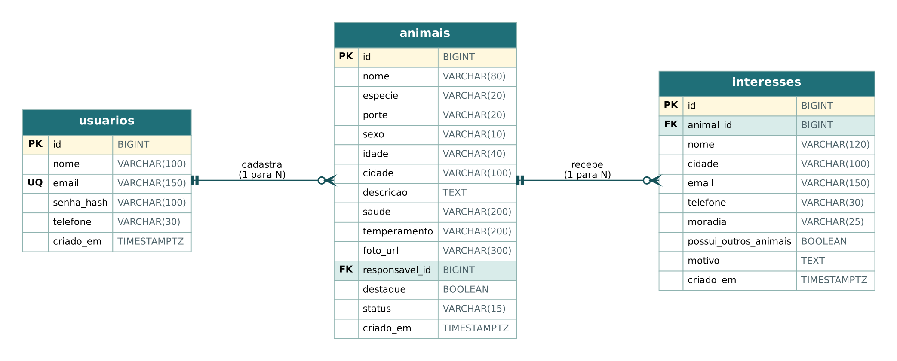
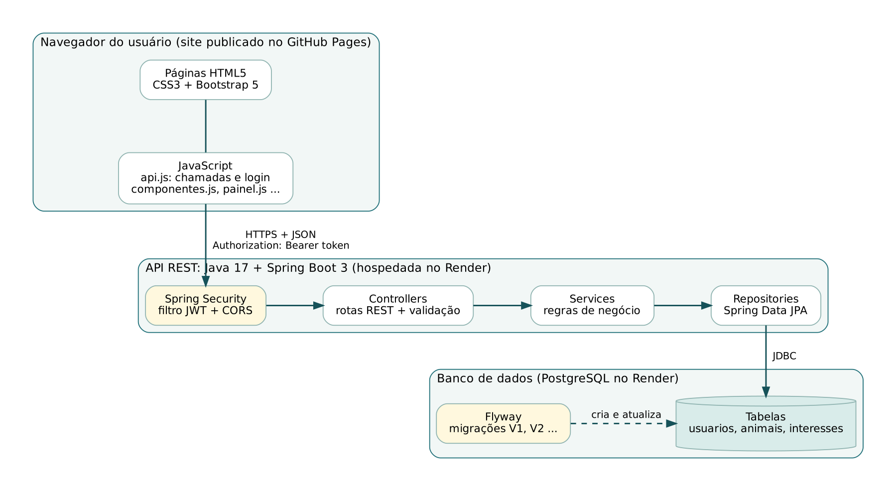
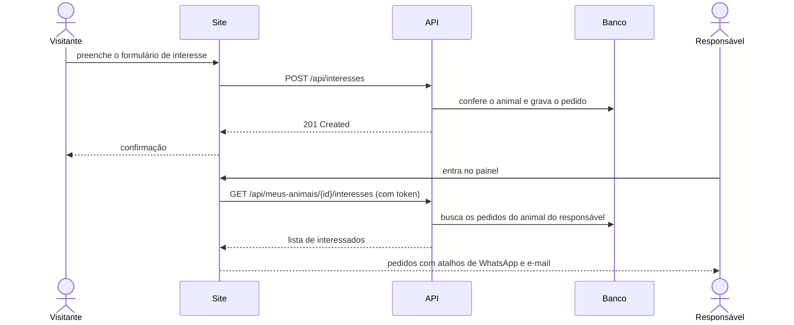

# Lar de Patas: documentação do projeto

Projeto acadêmico de Ciência da Computação. Plataforma web de adoção responsável de animais.

## Sumário

1. Introdução
2. Requisitos
3. Casos de uso
4. Modelagem de dados
5. Arquitetura
6. API REST
7. Segurança
8. Testes
9. Interface
10. Implantação
11. Limitações e trabalhos futuros

---

## 1. Introdução

### 1.1 Problema

Animais que precisam de um lar e pessoas dispostas a adotar muitas vezes não se encontram. Os anúncios ficam espalhados em redes sociais, sem padrão de informações, e quem divulga não tem como acompanhar os interessados.

### 1.2 Objetivo

Criar uma plataforma que reúna os animais disponíveis para adoção em um catálogo organizado, com perfil completo de cada um, e que facilite o contato entre quem quer adotar e quem cuida do animal.

### 1.3 Público

- **Adotantes:** pessoas que procuram um animal para adotar. Não precisam de conta.
- **Responsáveis:** pessoas e ONGs que divulgam animais. Precisam criar uma conta.

### 1.4 Escopo

Dentro do escopo: catálogo, filtros, perfil, formulário de interesse, contas de responsáveis, cadastro de animais e painel de acompanhamento. Fora do escopo desta versão: envio de fotos reais, pagamentos, mensagens dentro da plataforma e moderação de conteúdo.

---

## 2. Requisitos

### 2.1 Requisitos funcionais

| Código | Requisito |
|---|---|
| RF01 | O sistema deve exibir, na página inicial, os animais em destaque. |
| RF02 | O sistema deve listar os animais disponíveis para adoção em um catálogo. |
| RF03 | O sistema deve permitir filtrar o catálogo por espécie, porte, sexo e localização. |
| RF04 | O sistema deve exibir o perfil do animal com nome, idade, espécie, porte, sexo, localização, descrição, saúde, temperamento e informações de adoção. |
| RF05 | O sistema deve permitir que qualquer visitante manifeste interesse em adotar um animal por meio de um formulário. |
| RF06 | O sistema deve permitir criar uma conta de responsável com nome, e-mail, telefone e senha. |
| RF07 | O sistema deve permitir que o responsável entre e saia da sua conta. |
| RF08 | O sistema deve permitir que o responsável logado cadastre animais. |
| RF09 | O sistema deve exibir ao responsável a lista dos seus animais, com o total de interessados em cada um. |
| RF10 | O sistema deve exibir ao responsável os pedidos de adoção de cada animal seu, com os dados de contato do interessado e atalhos para WhatsApp e e-mail. |
| RF11 | O sistema deve permitir que o responsável marque um animal como adotado e reabra a adoção. |
| RF12 | O sistema deve retirar do catálogo os animais adotados e indicar no perfil que o animal já encontrou um lar. |
| RF13 | O sistema deve exibir na página inicial a quantidade de animais disponíveis, animais adotados e cidades atendidas. |

### 2.2 Regras de negócio

| Código | Regra |
|---|---|
| RN01 | Todo animal cadastrado nasce com status "disponível" e sem destaque. O cliente não pode definir esses dois campos. |
| RN02 | Cada animal pertence à conta que o cadastrou. Somente essa conta vê os interessados e altera o status. |
| RN03 | O e-mail de cada conta é único, sem diferenciar maiúsculas de minúsculas. |
| RN04 | A senha deve ter entre 8 e 72 caracteres. |
| RN05 | Não é possível manifestar interesse em um animal já adotado. |
| RN06 | O mesmo e-mail não pode manifestar interesse duas vezes no mesmo animal. |
| RN07 | O envio do formulário de interesse exige a aceitação do termo de responsabilidade. |
| RN08 | O contato do responsável não é exibido publicamente. O contato do interessado só é exibido ao responsável do animal escolhido. |

### 2.3 Requisitos não funcionais

| Código | Requisito |
|---|---|
| RNF01 | A interface deve ser responsiva, usando HTML5, CSS3 e Bootstrap. |
| RNF02 | As senhas devem ser armazenadas com hash BCrypt. |
| RNF03 | A autenticação deve ser sem estado (stateless), com token JWT de validade configurável (padrão de 12 horas). |
| RNF04 | Os dados enviados devem ser validados no navegador e no servidor. |
| RNF05 | Todo texto vindo da API deve ser escapado antes de entrar na página, para evitar injeção de HTML (XSS). |
| RNF06 | O esquema do banco deve ser versionado com migrações (Flyway). |
| RNF07 | O backend deve ter testes automatizados, executados a cada envio de código. |
| RNF08 | A API deve ter documentação interativa (OpenAPI e Swagger UI). |
| RNF09 | A interface deve seguir práticas básicas de acessibilidade: rótulos nos campos, foco visível, link para pular ao conteúdo, contraste adequado e respeito a quem prefere menos animação. |
| RNF10 | O código deve ser organizado em camadas (controller, service, repository) e em arquivos separados por responsabilidade. |
| RNF11 | A origem autorizada a chamar a API (CORS) deve ser configurável por variável de ambiente. |

---

## 3. Casos de uso

Atores: **Visitante** (quem quer adotar) e **Responsável** (conta logada). O responsável também pode fazer tudo o que o visitante faz. Os casos em amarelo exigem login.

### UC01 Consultar catálogo e filtrar animais

- **Ator:** Visitante
- **Pré-condição:** nenhuma
- **Fluxo principal:**
  1. O visitante abre a página "Animais".
  2. O sistema lista os animais disponíveis, do mais recente ao mais antigo.
  3. O visitante escolhe filtros de espécie, porte, sexo ou localização.
  4. O sistema atualiza a lista e informa quantos animais foram encontrados.
- **Fluxo alternativo:** se nenhum animal atende aos filtros, o sistema exibe a mensagem "Nenhum animal encontrado com esses filtros" e o visitante pode limpar os filtros.

### UC02 Ver perfil do animal

- **Ator:** Visitante
- **Pré-condição:** o animal existe
- **Fluxo principal:** o visitante escolhe um animal no catálogo ou na página inicial, e o sistema exibe o perfil completo e o botão para manifestar interesse.
- **Fluxos alternativos:**
  - Se o animal já foi adotado, o perfil indica que ele encontrou um lar e oferece um link para o catálogo.
  - Se o animal não existe, o sistema exibe "Animal não encontrado".

### UC03 Manifestar interesse em adotar

- **Ator:** Visitante
- **Pré-condição:** o animal está disponível
- **Fluxo principal:**
  1. O visitante abre o formulário a partir do perfil do animal.
  2. O visitante informa nome, cidade, e-mail, telefone, tipo de moradia, se já tem outros animais e o motivo da adoção, e aceita o termo de responsabilidade.
  3. O sistema valida os dados e registra o pedido.
  4. O sistema exibe a confirmação.
- **Fluxos alternativos:**
  - Dados inválidos: o sistema aponta os campos com problema.
  - O mesmo e-mail já pediu esse animal (RN06) ou o animal já foi adotado (RN05): o sistema recusa o pedido e informa o motivo.

### UC04 Criar conta de responsável

- **Ator:** Visitante
- **Fluxo principal:** o visitante informa nome, e-mail, telefone e senha (com confirmação). O sistema cria a conta, entra automaticamente e leva o usuário ao painel.
- **Fluxo alternativo:** se o e-mail já existe (RN03), o sistema informa e o usuário pode ir para a tela de entrar.

### UC05 Entrar

- **Ator:** Responsável
- **Fluxo principal:** o responsável informa e-mail e senha. O sistema valida e abre a sessão. Se a pessoa tentou abrir uma página restrita antes, volta para ela; senão, vai ao painel.
- **Fluxo alternativo:** com e-mail ou senha incorretos, o sistema responde "E-mail ou senha incorretos", sem revelar qual dos dois está errado.

### UC06 Cadastrar animal

- **Ator:** Responsável
- **Pré-condição:** estar logado
- **Fluxo principal:** o responsável preenche nome, idade, espécie, porte, sexo, cidade, saúde e descrição. O sistema grava o animal vinculado à conta, com status "disponível" (RN01), e oferece o link para o perfil.
- **Fluxo alternativo:** se a sessão expirou, o sistema leva o usuário à tela de entrar e depois volta ao cadastro.

### UC07 Ver meus animais

- **Ator:** Responsável
- **Pré-condição:** estar logado
- **Fluxo principal:** o sistema lista os animais da conta, com status e total de interessados em cada um.
- **Fluxo alternativo:** sem animais cadastrados, o sistema convida a cadastrar o primeiro.

### UC08 Ver interessados

- **Ator:** Responsável
- **Pré-condição:** estar logado e ser o dono do animal
- **Fluxo principal:** o responsável abre a lista de interessados de um animal e vê nome, cidade, moradia, se tem outros animais, motivo, data e atalhos de contato por WhatsApp e e-mail.
- **Fluxo alternativo:** sem pedidos, o sistema informa que ninguém demonstrou interesse ainda.

### UC09 Marcar como adotado ou reabrir adoção

- **Ator:** Responsável
- **Pré-condição:** estar logado e ser o dono do animal
- **Fluxo principal:** o responsável confirma a ação. O sistema altera o status. Um animal adotado sai do catálogo e deixa de aceitar pedidos; ao reabrir, volta ao catálogo.

---

## 4. Modelagem de dados

Um usuário (responsável) cadastra vários animais, e um animal recebe vários pedidos de interesse.

### 4.1 Dicionário de dados

**usuarios**

| Coluna | Tipo | Restrições | Descrição |
|---|---|---|---|
| id | BIGINT | chave primária | Identificador gerado automaticamente |
| nome | VARCHAR(100) | obrigatório | Nome da pessoa ou organização |
| email | VARCHAR(150) | obrigatório, único | Gravado em minúsculas |
| senha_hash | VARCHAR(100) | obrigatório | Hash BCrypt da senha |
| telefone | VARCHAR(30) | obrigatório | Contato do responsável |
| criado_em | TIMESTAMPTZ | obrigatório | Data de criação da conta |

**animais**

| Coluna | Tipo | Restrições | Descrição |
|---|---|---|---|
| id | BIGINT | chave primária | Identificador |
| nome | VARCHAR(80) | obrigatório | Nome do animal |
| especie | VARCHAR(20) | obrigatório | CACHORRO, GATO, COELHO ou OUTRA |
| porte | VARCHAR(20) | obrigatório | PEQUENO, MEDIO ou GRANDE |
| sexo | VARCHAR(10) | obrigatório | MACHO ou FEMEA |
| idade | VARCHAR(40) | obrigatório | Texto livre, como "3 anos" |
| cidade | VARCHAR(100) | obrigatório | Onde o animal está |
| descricao | TEXT | obrigatório | Apresentação do animal |
| saude | VARCHAR(200) | obrigatório | Vacinas, castração e tratamentos |
| temperamento | VARCHAR(200) | opcional | Jeito do animal |
| foto_url | VARCHAR(300) | opcional | Reservado para fotos reais |
| responsavel_id | BIGINT | chave estrangeira para usuarios | Dono do cadastro |
| destaque | BOOLEAN | obrigatório | Aparece na página inicial |
| status | VARCHAR(15) | obrigatório | DISPONIVEL ou ADOTADO |
| criado_em | TIMESTAMPTZ | obrigatório | Data do cadastro |

**interesses**

| Coluna | Tipo | Restrições | Descrição |
|---|---|---|---|
| id | BIGINT | chave primária | Identificador |
| animal_id | BIGINT | chave estrangeira para animais | Animal desejado |
| nome | VARCHAR(120) | obrigatório | Nome do interessado |
| cidade | VARCHAR(100) | obrigatório | Cidade do interessado |
| email | VARCHAR(150) | obrigatório | Contato |
| telefone | VARCHAR(30) | obrigatório | Contato |
| moradia | VARCHAR(25) | obrigatório | CASA_COM_QUINTAL, CASA_SEM_QUINTAL ou APARTAMENTO |
| possui_outros_animais | BOOLEAN | obrigatório | Se já convive com outros animais |
| motivo | TEXT | obrigatório | Por que quer adotar |
| criado_em | TIMESTAMPTZ | obrigatório | Data do pedido |

O esquema é criado pela migração `V1__schema_inicial.sql`, com índices em `animais(responsavel_id)`, `animais(status)` e `interesses(animal_id)`.

---

## 5. Arquitetura

### 5.1 Camadas do backend

| Camada | Responsabilidade |
|---|---|
| security | Filtro que lê o token JWT, regras de acesso por rota e CORS |
| controller | Recebe as requisições REST, valida o corpo e devolve JSON |
| service | Regras de negócio (por exemplo, "só o dono altera o status") |
| repository | Acesso ao banco com Spring Data JPA, incluindo a consulta dinâmica dos filtros do catálogo |
| model | Entidades JPA e enumerações |
| dto | Formatos de entrada e saída da API, com validação |
| exception | Tradução de erros em respostas padronizadas |

### 5.2 Fluxo: manifestar interesse e acompanhar o pedido

---

## 6. API REST

A documentação interativa completa fica em `/swagger-ui.html`. Rotas protegidas exigem `Authorization: Bearer <token>`.

| Método | Rota | Acesso | Descrição |
|---|---|---|---|
| GET | /api/animais | público | Catálogo, com filtros opcionais |
| GET | /api/animais/cidades | público | Cidades com animais disponíveis |
| GET | /api/animais/estatisticas | público | Contagens para a página inicial |
| GET | /api/animais/{id} | público | Perfil de um animal |
| POST | /api/interesses | público | Manifestar interesse |
| POST | /api/auth/registro | público | Criar conta |
| POST | /api/auth/login | público | Entrar |
| POST | /api/animais | login | Cadastrar animal |
| GET | /api/meus-animais | login | Animais da conta |
| GET | /api/meus-animais/{id}/interesses | login (dono) | Pedidos de um animal |
| PATCH | /api/meus-animais/{id}/status | login (dono) | Marcar como adotado ou reabrir |

Códigos de resposta usados: 200 (sucesso), 201 (criado), 400 (dados inválidos, com lista de erros por campo), 401 (sem login ou credenciais incorretas), 404 (não encontrado, inclusive animal de outra conta) e 409 (conflito, como e-mail repetido ou animal já adotado).

---

## 7. Segurança

| Medida | Como foi feita |
|---|---|
| Senhas | Guardadas com BCrypt; a senha original nunca é gravada |
| Sessão | Token JWT assinado, com validade; a API não guarda sessão no servidor |
| Segredo do token | Definido pela variável `JWT_SECRET`; sem ela, um segredo aleatório é gerado a cada início |
| Controle de acesso | Rotas públicas e protegidas definidas em um só lugar; operações do painel sempre filtram pelo dono |
| Enumeração de contas | Mensagem de login igual para e-mail inexistente e senha errada; animal de outra conta responde 404 |
| Privacidade | Contato do responsável fora das respostas públicas; contato do interessado só para o dono do animal |
| Entrada de dados | Validação com Bean Validation no servidor e verificação nos formulários |
| XSS | Todo texto dinâmico passa por função de escape antes de entrar no HTML; endereços de foto só são aceitos com `https` |
| Redirecionamento | O parâmetro de retorno do login só aceita nomes simples de página, evitando envio para sites externos |
| CORS | Origens autorizadas definidas por `CORS_ORIGINS` |

---

## 8. Testes

Os testes ficam em `backend/src/test` e usam banco H2 em memória, sem depender de PostgreSQL.

**Unitários (JwtServiceTest, 7 testes):** token válido, token com assinatura adulterada, token de outro segredo, token expirado, texto que não é token, segredo curto demais e geração de segredo aleatório.

**Integração (ApiIntegracaoTest, 14 testes):** catálogo público, estatísticas, animal inexistente, filtro inválido, criação de conta, e-mail duplicado, senha curta, login correto e incorreto, bloqueio sem login e com token inválido, validação dos campos do animal, ausência do contato do responsável nas respostas públicas e o fluxo completo de adoção (cadastro, interesse, isolamento entre contas, marcar como adotado e reabrir).

Execução: `mvn test` na pasta `backend`. No GitHub, o fluxo "Testes do backend" roda a cada envio de código e mostra o resultado na aba Actions.

---

## 9. Interface

### 9.1 Páginas

| Página | Arquivo | Função |
|---|---|---|
| Início | index.html | Apresentação, destaques, motivos para adotar, orientações, passo a passo e dúvidas |
| Animais | pages/animais.html | Catálogo com filtros |
| Perfil | pages/animal.html | Dados completos do animal |
| Quero adotar | pages/interesse.html | Formulário de interesse |
| Criar conta e Entrar | pages/criar-conta.html, pages/entrar.html | Acesso do responsável |
| Meus animais | pages/painel.html | Animais, interessados e status |
| Cadastrar animal | pages/cadastro.html | Cadastro de novo animal |

### 9.2 Decisões de design

- **Identidade:** teal como cor principal, amarelo nos botões de ação e coral em detalhes (coleira e coração), para transmitir cuidado e acolhimento.
- **Ilustrações:** cada animal é representado por um retrato ilustrado em SVG, com coleira e plaquinha, no lugar de emojis ou fotos. As ilustrações são geradas por código (`ilustracoes.js`) e podem ser trocadas por fotos reais quando o campo `foto_url` for usado.
- **Tipografia:** Bricolage Grotesque nos títulos e Figtree no texto, com linhas de leitura curtas.
- **Bootstrap:** grade responsiva, barra de navegação recolhível, accordion nas dúvidas, collapse para os filtros no celular e componentes de formulário com validação.
- **Estados da interface:** indicador de carregamento, mensagens de erro específicas, tela de "não encontrado" e mensagens de lista vazia.

---

## 10. Implantação

| Parte | Onde | Observação |
|---|---|---|
| Site | GitHub Pages | Publicado por GitHub Actions a partir da pasta `frontend` |
| API | Render (Web Service com Docker) | Variáveis: dados do banco, `JWT_SECRET` e `CORS_ORIGINS` |
| Banco | Render (PostgreSQL) | Esquema criado e atualizado pelo Flyway |

O passo a passo completo está em [PUBLICAR.md](../PUBLICAR.md). Os planos gratuitos entram em modo de espera quando ficam sem uso, e o banco gratuito do Render tem prazo de validade limitado, por isso vale conferir as condições atuais antes de uma apresentação.

---

## 11. Limitações e trabalhos futuros

| Item | Situação |
|---|---|
| Envio de fotos reais | Não implementado; o campo `foto_url` já existe no banco |
| Recuperação de senha e confirmação de e-mail | Não implementados |
| Limite de tentativas de login | Não implementado |
| Paginação do catálogo | Não implementada |
| Editar e excluir animal | Não implementado |
| Tela para definir animais em destaque | Não implementada; o destaque é definido nos dados |
| Moderação de anúncios | Não implementada |
| LGPD | Um projeto real precisa de política de privacidade, consentimento e forma de excluir dados pessoais |
| Notificações | O responsável precisa abrir o painel para ver novos pedidos; e-mail automático seria um próximo passo |
